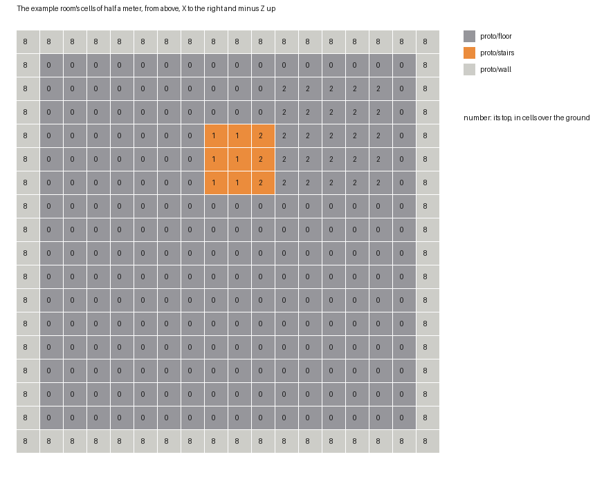
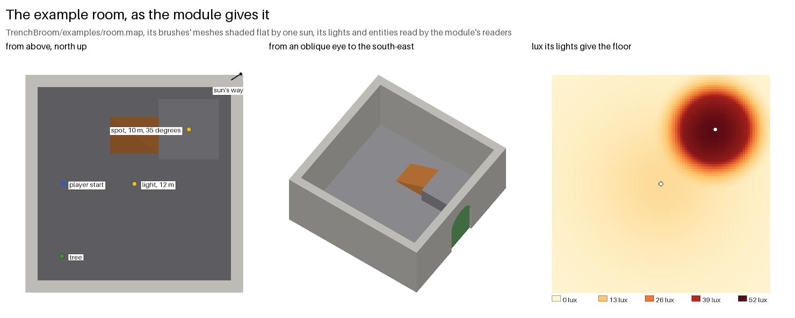

# Levels devlog

What landed in Levels, by day and newest first, with the pictures taken on the way, the captures the
repository keeps under `.github/assets` and the pictures made while an item was built, kept under
`.github/assets/readings` as WebP files named by their day, each on the day its name says, and the
notes written beside them as Markdown files named the same way. A line under Done names the item of
.github/REVIEW.md or .github/REVIEW-ARCHIVE.md and the commit that closed it.

## 2026-11-19

Commits that day

- `1993c48` TrenchBroom's guide tables every class the module reads with its keys, defaults and
  reader, written from the editor's classes by a test that holds it.
- `19c51c2` A door's and a button's speed and wait are read from their keys, so a mover is timed
  alike wherever it is played.
- `0fe4b1b` The world's sky name and its ambient light's color and lux are read from its keys, with
  their defaults in the editor's classes.
- `2590e7a` A trigger's volume is given as a hull a brush, and a place is said to stand in it by the
  same rule the cells keep.
- `d6f26ba` A button travels as a door does, and a rotating part turns about the axis and at the
  speed its keys give.
- `1040b27` A light's style is read as the letter pattern its brightness follows, ten letters a
  second, from its pattern or the conventional preset its style numbers.

## 2026-11-18

The example room's cells of half a meter seen from above, each column the material of its topmost
cell and the number its top in cells over the ground, the floor at none, the ramp rising to the
platform at 2 and the walls at 8, the door under the wall above its doorway.

The example room as the module alone gives it, from build/sheet/room.sh: its meshes from above,
north up, each face in the Materials module's prototype tone for its material, floor and wall one
tone, and lighter the higher it stands, with its lights, the spot's way, the sun's and its entities
marked; from an oblique eye to the south-east, the ramp, the platform and the door in its doorway;
and the lux its point light and its spot give the floor by LevelLight.IlluminanceAt, 52 at the most
under the spot.

A made level through every reader and writer of the module at 100, 10,000 and 100,000 brushes,
a third each boxes, ramps and boxes turned by 30 degrees, every hundredth a door's, with a light,
a spot and a tree for each hundred, read back equal at each count. Each time is the best of up to
five runs within five seconds on a machine under a load of 10 to 12 at 18:10, from
`dotnet run -c Release --project build/bench`.

| Brushes | Step | ms | MiB allocated |
|---|---|---|---|
| 100 | Level.Write | 1.7 | 0.8 |
| 100 | Level.Parse | 2.9 | 1.4 |
| 100 | Level.Save | 1.7 | 0.8 |
| 100 | Level.Load | 2.8 | 1.6 |
| 100 | LevelBrush.Polygons, every brush | 3.9 | 1.7 |
| 100 | LevelGeometry.Meshes, every entity | 4.8 | 2.0 |
| 100 | LevelGeometry.Hulls, every entity | 5.1 | 1.9 |
| 100 | LevelGeometry.Triangles, the world | 0.1 | 0.2 |
| 100 | Placement, Light and Tree, every entity | 0.1 | 0.0 |
| 100 | KeysText and ParseKeys, every entity | 0.0 | 0.0 |
| 100 | the level | 5 entities, 567 faces, 1,056 triangles in the world, 0.06 million characters, 0.1 MiB on disk | round trip equal |
| 10,000 | Level.Write | 66.2 | 83.0 |
| 10,000 | Level.Parse | 124.4 | 140.0 |
| 10,000 | Level.Save | 91.5 | 83.0 |
| 10,000 | Level.Load | 181.7 | 163.4 |
| 10,000 | LevelBrush.Polygons, every brush | 106.0 | 168.2 |
| 10,000 | LevelGeometry.Meshes, every entity | 118.2 | 201.0 |
| 10,000 | LevelGeometry.Hulls, every entity | 80.3 | 185.5 |
| 10,000 | LevelGeometry.Triangles, the world | 3.4 | 15.6 |
| 10,000 | Placement, Light and Tree, every entity | 1.4 | 1.9 |
| 10,000 | KeysText and ParseKeys, every entity | 0.5 | 1.2 |
| 10,000 | the level | 401 entities, 56,667 faces, 105,600 triangles in the world, 6.10 million characters, 5.8 MiB on disk | round trip equal |
| 100,000 | Level.Write | 1024.4 | 841.6 |
| 100,000 | Level.Parse | 1369.3 | 1408.5 |
| 100,000 | Level.Save | 743.6 | 841.6 |
| 100,000 | Level.Load | 1217.7 | 1650.1 |
| 100,000 | LevelBrush.Polygons, every brush | 561.9 | 1681.8 |
| 100,000 | LevelGeometry.Meshes, every entity | 649.3 | 1984.1 |
| 100,000 | LevelGeometry.Hulls, every entity | 682.0 | 1854.3 |
| 100,000 | LevelGeometry.Triangles, the world | 21.6 | 148.3 |
| 100,000 | Placement, Light and Tree, every entity | 11.2 | 19.0 |
| 100,000 | KeysText and ParseKeys, every entity | 3.1 | 11.9 |
| 100,000 | the level | 4,001 entities, 566,667 faces, 1,056,000 triangles in the world, 63.17 million characters, 60.2 MiB on disk | round trip equal |

One brush of many faces, a prism of n sides and its two ends, its polygons alone: 18 faces in 0.0
ms; 34 faces in 0.1 ms; 66 faces in 0.7 ms; 130 faces in 6.0 ms. The process's peak working set is
1,337 MiB.

At 100,000 brushes Level.Parse is the first step slow enough to see, 1,369 ms and 1,409 MiB
allocated for 63.17 million characters, some 23 bytes a character, a token's record and its text a
token, and Level.Load, which reads the file and parses it, takes 1,218 ms and 1,650 MiB. Every
brush's Polygons comes next in memory, 1,682 MiB, some 17 KiB a brush.

The format reading again after a brush's polygons are built with no list or closure a face, the same
made level at 100, 10,000 and 100,000 brushes. Each time is the best of up to five runs within five
seconds on a machine under a load of 14 at 18:42, from `dotnet run -c Release --project
build/bench`.

| Brushes | Step | ms | MiB allocated |
|---|---|---|---|
| 100 | Level.Write | 1.3 | 0.8 |
| 100 | Level.Parse | 2.2 | 0.1 |
| 100 | the level Level.Parse keeps | | 0.1 |
| 100 | Level.Save | 1.3 | 0.8 |
| 100 | Level.Load | 2.2 | 0.4 |
| 100 | LevelBrush.Polygons, every brush | 1.3 | 0.2 |
| 100 | LevelGeometry.Meshes, every entity | 1.5 | 0.5 |
| 100 | LevelGeometry.Hulls, every entity | 1.4 | 0.2 |
| 100 | LevelGeometry.Triangles, the world | 0.1 | 0.2 |
| 100 | Placement, Light and Tree, every entity | 0.0 | 0.0 |
| 100 | KeysText and ParseKeys, every entity | 0.0 | 0.0 |
| 100 | the level | 5 entities, 567 faces, 1,056 triangles in the world, 0.06 million characters, 0.1 MiB on disk | round trip equal |
| 10,000 | Level.Write | 61.4 | 83.0 |
| 10,000 | Level.Parse | 60.9 | 12.3 |
| 10,000 | the level Level.Parse keeps | | 11.4 |
| 10,000 | Level.Save | 63.2 | 83.0 |
| 10,000 | Level.Load | 79.8 | 35.6 |
| 10,000 | LevelBrush.Polygons, every brush | 17.1 | 15.6 |
| 10,000 | LevelGeometry.Meshes, every entity | 27.8 | 47.0 |
| 10,000 | LevelGeometry.Hulls, every entity | 25.2 | 19.5 |
| 10,000 | LevelGeometry.Triangles, the world | 5.4 | 15.6 |
| 10,000 | Placement, Light and Tree, every entity | 0.9 | 0.4 |
| 10,000 | KeysText and ParseKeys, every entity | 0.4 | 0.8 |
| 10,000 | the level | 401 entities, 56,667 faces, 105,600 triangles in the world, 6.10 million characters, 5.8 MiB on disk | round trip equal |
| 100,000 | Level.Write | 736.7 | 841.6 |
| 100,000 | Level.Parse | 808.1 | 122.5 |
| 100,000 | the level Level.Parse keeps | | 115.9 |
| 100,000 | Level.Save | 694.1 | 841.6 |
| 100,000 | Level.Load | 707.9 | 364.1 |
| 100,000 | LevelBrush.Polygons, every brush | 134.4 | 156.1 |
| 100,000 | LevelGeometry.Meshes, every entity | 210.9 | 443.2 |
| 100,000 | LevelGeometry.Hulls, every entity | 224.9 | 194.9 |
| 100,000 | LevelGeometry.Triangles, the world | 27.0 | 148.3 |
| 100,000 | Placement, Light and Tree, every entity | 6.2 | 3.8 |
| 100,000 | KeysText and ParseKeys, every entity | 2.6 | 7.9 |
| 100,000 | the level | 4,001 entities, 566,667 faces, 1,056,000 triangles in the world, 63.17 million characters, 60.2 MiB on disk | round trip equal |

At 100,000 brushes every brush's Polygons allocates 156.1 MiB in 134 ms, where it allocated 1,681.8
MiB in 544 to 562 ms, some 1.6 KiB a brush; Meshes 443.2 MiB in 211 ms, where it took 1,984.1 MiB,
some 4.5 KiB a brush; and Hulls 194.9 MiB in 225 ms, where it took 1,854.3 MiB, some 2.0 KiB a
brush. The process's peak working set is 1,253 MiB, where it was 1,258, so the level and its text
hold the peak, not the building of its shapes.

The format reading again after Level.Load reads its file through a stream into a window of 64
kilo-characters, the same made level at 100, 10,000 and 100,000 brushes. Each time is the best of up
to five runs within five seconds on a machine under a load of 21 to 35 at 19:39, so the times are
read with care and the bytes as they stand, from `dotnet run -c Release --project build/bench`.

| Brushes | Step | ms | MiB allocated |
|---|---|---|---|
| 100 | Level.Write | 1.6 | 0.8 |
| 100 | Level.Parse | 3.4 | 0.1 |
| 100 | the level Level.Parse keeps | | 0.1 |
| 100 | Level.Save | 1.7 | 0.8 |
| 100 | Level.Load | 3.4 | 0.4 |
| 100 | LevelBrush.Polygons, every brush | 1.7 | 0.2 |
| 100 | LevelGeometry.Meshes, every entity | 2.1 | 0.5 |
| 100 | LevelGeometry.Hulls, every entity | 2.0 | 0.2 |
| 100 | LevelGeometry.Triangles, the world | 0.2 | 0.2 |
| 100 | Placement, Light and Tree, every entity | 0.1 | 0.0 |
| 100 | KeysText and ParseKeys, every entity | 0.0 | 0.0 |
| 100 | the level | 5 entities, 567 faces, 1,056 triangles in the world, 0.06 million characters, 0.1 MiB on disk | round trip equal |
| 10,000 | Level.Write | 58.8 | 83.0 |
| 10,000 | Level.Parse | 80.2 | 12.3 |
| 10,000 | the level Level.Parse keeps | | 11.4 |
| 10,000 | Level.Save | 95.4 | 83.0 |
| 10,000 | Level.Load | 90.9 | 12.6 |
| 10,000 | LevelBrush.Polygons, every brush | 27.8 | 15.6 |
| 10,000 | LevelGeometry.Meshes, every entity | 30.3 | 47.0 |
| 10,000 | LevelGeometry.Hulls, every entity | 24.1 | 19.5 |
| 10,000 | LevelGeometry.Triangles, the world | 10.5 | 15.6 |
| 10,000 | Placement, Light and Tree, every entity | 1.1 | 0.4 |
| 10,000 | KeysText and ParseKeys, every entity | 0.5 | 0.9 |
| 10,000 | the level | 401 entities, 56,667 faces, 105,600 triangles in the world, 6.10 million characters, 5.8 MiB on disk | round trip equal |
| 100,000 | Level.Write | 1640.6 | 841.6 |
| 100,000 | Level.Parse | 921.7 | 122.5 |
| 100,000 | the level Level.Parse keeps | | 115.9 |
| 100,000 | Level.Save | 937.7 | 841.6 |
| 100,000 | Level.Load | 729.3 | 122.8 |
| 100,000 | LevelBrush.Polygons, every brush | 131.0 | 156.1 |
| 100,000 | LevelGeometry.Meshes, every entity | 209.3 | 443.2 |
| 100,000 | LevelGeometry.Hulls, every entity | 187.1 | 194.9 |
| 100,000 | LevelGeometry.Triangles, the world | 27.7 | 148.3 |
| 100,000 | Placement, Light and Tree, every entity | 4.0 | 3.8 |
| 100,000 | KeysText and ParseKeys, every entity | 3.9 | 8.5 |
| 100,000 | the level | 4,001 entities, 566,667 faces, 1,056,000 triangles in the world, 63.17 million characters, 60.2 MiB on disk | round trip equal |

At 100,000 brushes Level.Load allocates 122.8 MiB, where it allocated 364.1, the file's 63.17
million characters no longer held as one string, and Level.Parse of the same text in hand allocates
122.5, the level 115.9 of both. The process's peak working set is 1,258 MiB, as it was before the
change.

The format reading again after Level.Parse reads its tokens where they stand in the text, the same
made level at 100, 10,000 and 100,000 brushes, with a row for the level Level.Parse keeps, the
memory the level read holds once the collector has run. Each time is the best of up to five runs
within five seconds on a machine under a load of 13 to 15 at 18:37, from `dotnet run -c Release
--project build/bench`.

| Brushes | Step | ms | MiB allocated |
|---|---|---|---|
| 100 | Level.Write | 1.6 | 0.8 |
| 100 | Level.Parse | 2.8 | 0.1 |
| 100 | the level Level.Parse keeps | | 0.1 |
| 100 | Level.Save | 1.7 | 0.8 |
| 100 | Level.Load | 2.8 | 0.4 |
| 100 | LevelBrush.Polygons, every brush | 4.3 | 1.7 |
| 100 | LevelGeometry.Meshes, every entity | 4.8 | 2.0 |
| 100 | LevelGeometry.Hulls, every entity | 5.1 | 1.9 |
| 100 | LevelGeometry.Triangles, the world | 0.1 | 0.2 |
| 100 | Placement, Light and Tree, every entity | 0.1 | 0.0 |
| 100 | KeysText and ParseKeys, every entity | 0.0 | 0.0 |
| 100 | the level | 5 entities, 567 faces, 1,056 triangles in the world, 0.06 million characters, 0.1 MiB on disk | round trip equal |
| 10,000 | Level.Write | 65.3 | 83.0 |
| 10,000 | Level.Parse | 75.9 | 12.3 |
| 10,000 | the level Level.Parse keeps | | 11.4 |
| 10,000 | Level.Save | 85.4 | 83.0 |
| 10,000 | Level.Load | 93.7 | 35.6 |
| 10,000 | LevelBrush.Polygons, every brush | 65.0 | 168.2 |
| 10,000 | LevelGeometry.Meshes, every entity | 90.2 | 201.0 |
| 10,000 | LevelGeometry.Hulls, every entity | 126.7 | 185.5 |
| 10,000 | LevelGeometry.Triangles, the world | 5.1 | 15.6 |
| 10,000 | Placement, Light and Tree, every entity | 2.8 | 1.9 |
| 10,000 | KeysText and ParseKeys, every entity | 0.7 | 0.8 |
| 10,000 | the level | 401 entities, 56,667 faces, 105,600 triangles in the world, 6.10 million characters, 5.8 MiB on disk | round trip equal |
| 100,000 | Level.Write | 995.1 | 841.6 |
| 100,000 | Level.Parse | 744.0 | 122.5 |
| 100,000 | the level Level.Parse keeps | | 115.9 |
| 100,000 | Level.Save | 854.6 | 841.6 |
| 100,000 | Level.Load | 1197.2 | 364.1 |
| 100,000 | LevelBrush.Polygons, every brush | 543.8 | 1681.8 |
| 100,000 | LevelGeometry.Meshes, every entity | 1302.4 | 1984.1 |
| 100,000 | LevelGeometry.Hulls, every entity | 886.5 | 1854.3 |
| 100,000 | LevelGeometry.Triangles, the world | 52.0 | 148.3 |
| 100,000 | Placement, Light and Tree, every entity | 20.2 | 19.0 |
| 100,000 | KeysText and ParseKeys, every entity | 4.6 | 7.9 |
| 100,000 | the level | 4,001 entities, 566,667 faces, 1,056,000 triangles in the world, 63.17 million characters, 60.2 MiB on disk | round trip equal |

At 100,000 brushes Level.Parse takes 744 ms and allocates 122.5 MiB, where it took 1,369 ms and
1,409 MiB, and the level it reads keeps 115.9 MiB of them, so the reading's own allocations are some
7 MiB beside the level. Level.Load allocates 364.1 MiB, the file's text read whole into one string
of 63.17 million characters and the level. The process's peak working set is 1,258 MiB, where it was
1,337, and every brush's Polygons, Meshes and Hulls allocate the most of the steps, the next to
read.

Commits that day

- `9b6e8a1` Clip, nodraw, trigger and skip faces are read by their names, drawn by none and collided
  with by clip and nodraw alone, and a trigger brush is a volume and no hull.
- `ad4d7ed` The example room's sheet takes its tones from the Materials module's prototype table,
  and the review holds a handoff of what the module gives and what its readers still owe.
- `a7dd3b3` A door's travel is read from the keys the module's door class names, the way it opens by
  its size that way less its lip.
- `1e5ecff` A level gives every problem it holds at once, each named by its entity and its key or
  brush, where reading stops at the first.
- `669fd24` The example room has a sheet drawn from the module alone, its meshes from above and from
  an oblique eye and the lux its lights give the floor, with the script that makes it.
- `dc958c9` Cells are made back into boxes of one material by a stated greedy order, so a level
  built of blocks is saved as brushes that give the same cells.
- `ff5a531` An entity's outputs are read as the event, target, input, parameter, delay and times
  they hold, and a level finds the entities a target name names.
- `7ddc1e2` A binding reads a level through a view in which TrenchBroom's layers and groups are the
  world and a layer omitted from export is left out, while the level writes back as it was read.
- `5b63d28` The cells of a grid a brush fills are given with their materials by stated rules, so two
  block readers lay the same blocks, beside a test of a point inside a brush.
- `4d9629d` A light fades to its range by glTF's window, the same source its spot's cone stands on.
- `00124e9` A level is loaded through a stream into a moving window, so a large file is never held
  as one text and loading allocates what parsing does.
- `fc1af66` A spot's light off its axis is said and given as a number, full inside its inner cone
  and falling to nothing at its outer one as glTF's lights extension gives it.
- `efb443c` An entity's place, light and tree are written back to its keys, only what differs, so a
  tool saves what it loaded and a level saved unedited is the same text.
- `a3a266f` A light's range is said and given as a number, its light falling as the inverse square
  of the distance and brought smoothly to nothing at the range.
- `bfe7cc5` The module ships an example room of every class it reads, which its tests write and load
  through the README's binding, and the checks hold the link row and every tracked text to naming no
  engine.
- `4566bdb` The README says which way texture coordinates run, the picture's top left at the origin
  and V growing down it, held by a test, and its links stand above its title.
- `2298b58` The README states the module's conventions of materials, collision, names and faults
  beside its units, and a spot's conversion for another way of counting its lumens.
- `692e95d` A tree's species has no default, the key's text or nothing, for an engine's vegetation
  to resolve.
- `919adce` The module names no engine and speaks of none in particular, its documents, summaries,
  comments and tests said in its own terms, the assembly's name apart.
- `6d05415` A brush's polygons, meshes and hulls are built in a few kilobytes a brush where they
  took some twenty, giving the same shapes.
- `b29d55b` A level's text is read with its tokens left where they stand, a large level's reading
  allocating some two bytes a character where it took twenty-five, and the checks print their
  sentences whole.
- `bc10f0e` A ray is met against a brush or the nearest of many, how far along it the solid begins,
  so a test or a game reads it alike in either engine.
- `3252c8a` A slab of a ground outline, a wall and a ramp between two points of the ground, and any
  brush made along X put along a line, are made by the module.
- `b2add4a` A brush of any convex outline is public and refuses one that bends in or has no depth,
  and the README links the devlog.
- `3386a62` The module's checks are four tests from Tools' revised form, each failing with a
  sentence that names what it found and the rule.
- `ef3b53b` A level hands its entities to an engine one by one, and a fault its text causes is named
  by the entity it stands in.
- `39d67de` An entity gives its target name and the name an engine shows it by, its target name,
  else its class, else its index.
- `d7941de` A level is read through the engine's files as its pictures are, and the README's binding
  reads it so.
- `af7f4d7` The bench takes a made level of up to 100,000 brushes through every reader and writer,
  holds its round trip equal and prints a sheet of each step's time and memory, which the devlog
  carries.
- `46a7f8c` The tests take the checks every module keeps from the Tools submodule in place of their
  own copies, and a clone without the submodule stops with the command that fetches it.
- `4e632dc` The shapes are said in their own terms, the arch's segments each spanning an equal share
  of its angle.
- `3d6ae0c` The README names every public type of the library in a table of what a binding reads,
  and a test fails where one is named nowhere.
- `26a4204` The width test reads every folder and the project files, the workflow and the scripts as
  well, two comments past 100 columns are rewrapped, and the doorway is said in its own terms.
- `80bbc12` A test fails where a public type, member or summary of the library names either engine,
  so the library reads as one any engine takes.
- `27aea49` A test fails where the library references an engine, a window or a graphics API, read
  from its assembly and the packages its build resolved.
- `1835bf5` The agents guide names the bench in its table of areas, with the command that runs it.
- `2e947c6` The library's assembly and package are named 3DEngine.Levels and its tests'
  3DEngine.Levels.Tests, while its folders, project files and namespace keep the name Levels.
- `6dd20f0` The README's smallest binding is the tests' host, run with no engine against a level and
  a folder of pictures, and a test holds the README's copy of it to the host's code.
- `460490c` The README says how to bind the module in any engine, the interfaces it declares, the
  conventions of what it gives out and the smallest binding that works.
- `2bd5ec2` A brush too far out for its corners to be found is refused with the face, the distance
  and the bound named, where its message said only that its planes close no solid.
- `0a79f72` A bench outside the solution reads, writes and builds a level of 10,000 brushes and one
  brush of many faces, giving each step's time and memory.
- `4eb35e2` A point's dot product, cross product and length are public, so an engine binding the
  module reads a face's plane with the module's own arithmetic.
- `85d43c5` A level holding what map text cannot, a trailing backslash, a material that is not one
  word, a number of no end or a game of two lines, is refused when written rather than written as
  text that reads back as another.
- `67b5dca` A flat brush, two of its planes facing each other in one place, is refused as having no
  volume, and the reader is held to refusing text cut short or spoiled with a named exception.
- `58d537f` A test holds the classes TrenchBroom is given to the module's readers, each with the
  keys they read and the defaults they take.
- `2f3017a` A level's tree is read as a species' name and a seed, a tree of no species being the
  black tupelo TrenchBroom shows, and the sun's default strength is said to give way to a sky that
  places the sun.
- `d7daca5` A level's point lights, spots and sun are read from their classes in lumens and lux with
  their color in linear sRGB, and TrenchBroom is given the three classes with their keys and
  defaults.
- `86b460e` An entity's keyvalues are given as the lines the level file writes and read back from
  them, and an entity's meshes as one shape of triangles for a static body.
- `2c0f964` A level's materials are found by the names both engines read them by, a prototype under
  proto/ over a picture of 512 texels and any other a PNG or a JPEG of its name under textures/,
  through the files an engine gives.
- `b19895a` A level's entity gives the place and the turn an engine stands it at in meters with Y
  up, read from its origin and angles as both engines place it, and reads a key as numbers with a
  malformed one refused by name.
- `a290cdf` Comment lines hold to 100 columns under a test that reads the sources, the long ones
  rewrapped with no word changed, and the agents guide links the devlog.
- `1bb027e` The face texel's coordinates are written with the word dot where the middle dot stood,
  the style guide says the mark is not used, and the devlog lists the code's move.

## 2026-11-17

Commits that day

- `8e16b33` The ignore file's note on the pictures folder names no one, and the guides spell
  canceled.

## 2026-10-31

Done that day

- Item 1 at `751c272`. The documents, one commit.
- Item 2 at `3ca2ac0`. The skeleton, one commit after item 1.
- Item 3 at `a01b2df`. The code's move.

Commits that day

- `a01b2df` TrenchBroom's game config and the format's base entity classes move here, which an
  engine copies and names its own classes beside, held to the format's scale and its units a meter.
- `01c44b0` A level entity's brushes are given out as triangles a mesh a material and as convex
  hulls a brush, in meters with Y up, their texels over the pictures an engine says its materials
  have.
- `3ca2ac0` The module gains its solution, an empty library whose public members need summaries, a
  test that it loads, the version at 0.1 and a build workflow on Linux, Windows and macOS.
- `751c272` The module gains its documents, AGENTS.md, the README, STYLE.md, COMMITS.md and the code
  of conduct as the engines keep them, with git's ignore and attribute files.
